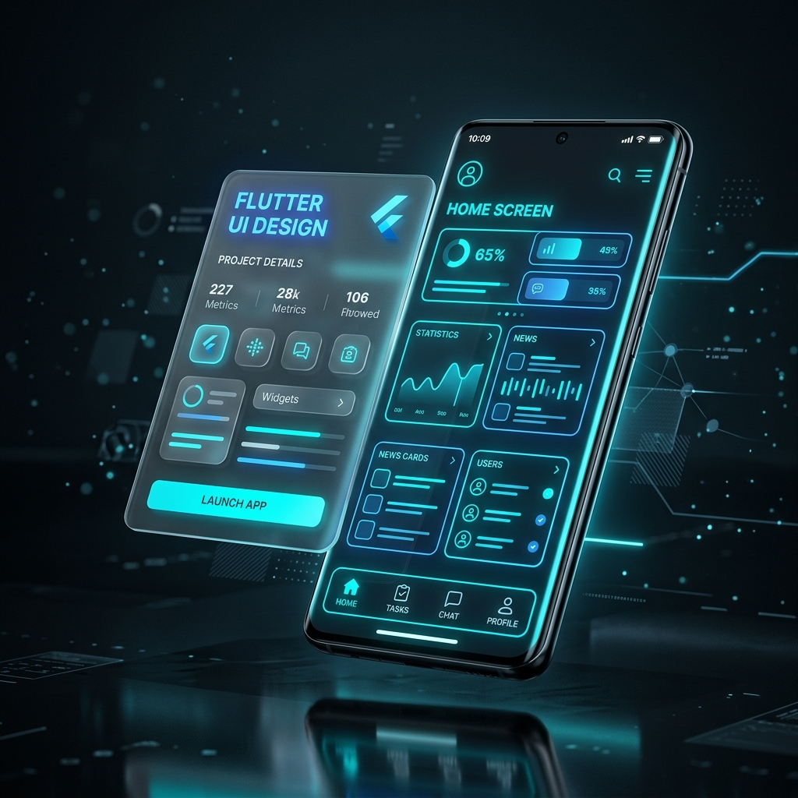
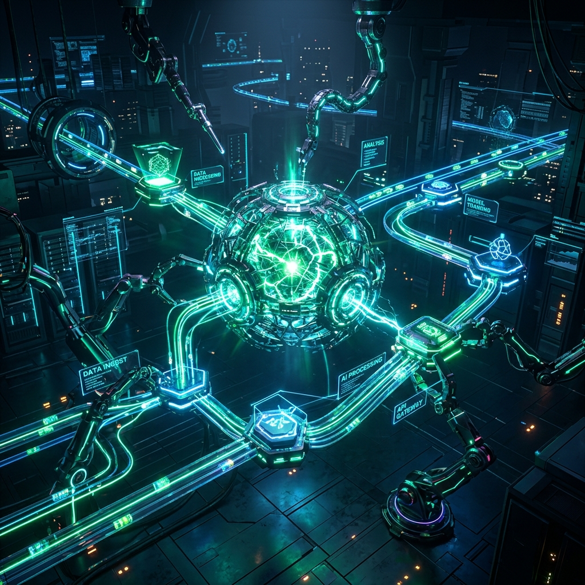

# 🛸 فن البرمجية | Fan Al-Barmajiah
### محرك بناء التجارب الرقمية التفاعلية وهندسة الأنظمة الحية 🚀

<div align="center">
  
  <br>
  
  [](https://github.com/fanalelan-oss/Fan-Barmajiah)
  [](https://firebase.google.com/)
  [](https://nodejs.org/)
  [](https://fan-alelan.com)
  
  <p align="center">
    <strong>«نحن لا نكتب أكواداً عادية.. نحن نبني كيانات برمجية حية»</strong>
    <br>
    تجربة ويب سينمائية ثلاثية الأبعاد مبنية بأحدث معايير الـ Creative Web وتصميم الزجاج البلوري مع نظام متكامل لإدارة الخدمات الرقمية والهندسة السحابية.
  </p>
</div>

---

## 📸 جولة بصرية في المنصة (Visual Showcase)

<div align="center">
  <table>
    <tr>
      <td width="33%" align="center">
        
        <br>
        <strong>📱 تطبيقات Flutter فائقة الرشاقة</strong>
      </td>
      <td width="33%" align="center">
        
        <br>
        <strong>🛍️ متاجر تفاعلية وهندسة تحويل</strong>
      </td>
      <td width="33%" align="center">
        
        <br>
        <strong>🤖 روبوتات الأتمتة والذكاء الاصطناعي</strong>
      </td>
    </tr>
  </table>
</div>

---

## 🌟 الهيكل المعماري والصفحات المخصصة (Core Architecture)

تتألف المنصة من منظومة صفحات مستقلة تم تصميم كل منها كـ Landing Page متكاملة تدعم السيو والتحويل الرقمي:

```
Fan-Barmajiah/
│
├── 🏠 index.html                    # الواجهة الرئيسية السينمائية ثلاثية الأبعاد
├── ℹ️ about.html                    # صفحة من نحن وفلسفة البناء البرمجي
├── 🗂️ services.html                 # دليل الخدمات التفاعلي مع تصفية الفئات (Filter Matrix)
├── 📝 blog.html                     # منصة المقالات ودراسات الحالة البرمجية
│
├── 🚀 صفحات الخدمات التخصصية العميقة:
│   ├── 📱 service-mobile.html       # تطبيقات الهواتف الذكية (iOS & Android - Flutter 60fps)
│   ├── 🛒 service-ecommerce.html    # المتاجر والمنظومات التجارية الرقمية عالية الأداء
│   ├── ☁️ service-cloud-erp.html    # البنية السحابية وهندسة قواعد البيانات وMicroservices
│   ├── 🤖 service-automation-ai.html # الأتمتة والروبوتات البرمجية والذكاء الاصطناعي
│   ├── ⚡ service-refactoring.html   # تدقيق الأداء وإعادة هيكلة الأكواد المعقدة
│   └── 🎯 service-consulting.html   # الاستشارات التقنية والتوجيه المعماري للمشاريع
│
├── 🎨 ملفات التصميم والفيزياء:
│   ├── style.css                    # نظام الأنماط الشامل (Dark & Daylight Themes)
│   └── app.js                       # محرك الحركات، فيزياء النجوم، وتتبع السكرول
│
└── ⚙️ إعدادات النشر السحابي (Deployment & CI/CD):
    ├── package.json                 # تعريف المشروع واعتمادات خادم Node.js
    ├── server.js                    # خادم Express المخصص لدعم الروابط النظيفة والأصول
    ├── apphosting.yaml              # إعدادات Firebase App Hosting و Google Cloud Run
    └── firebase.json                # إعدادات Firebase Hosting التقليدية
```

---

## ✨ أبرز المميزات والتقنيات التفاعلية (Key Interactive Features)

### 1. ☀️🌙 نظام المظهر المزدوج وزر التبديل الحر (Dual Theme & Floating Toggle)
- **الوضع الليلي (Dark Cyberpunk):** خلفية فضائية عميقة بدرجات الكحلي والأسود الزجاجي مع توهجات نيون سيان وبنفسجي وذهبي.
- **الوضع النهاري (Daylight Clean):** تصميم بلوري أبيض نقي متناسق بالكامل (Linear/Vercel Aesthetic) مريح للقراءة مع تباين عالي للنصوص.
- **زر التبديل المباشر:** أيقونة شمس ☀️ وقمر 🌙 حرة طافية على الموقع بدون أي حوافر أو كبسولات إضافية، مع فيزياء دوران ارتدادي تفاعلي.

### 2. 🌌 محاكي النجوم الفضولية الذكي (Curious Cosmic Stars AI Physics)
- مرسوم عبر **HTML5 Canvas 2D** بكثافة متوازنة وحسابات فيزيائية حية.
- **نمط الفضول (Curiosity Mode):** عند ثبات مؤشر الفأرة لمدة 3 ثوانٍ، تسبح النجوم برقة نحو المؤشر كأنها كائنات تستكشف الزائر.
- **الانفراج السلس (Smooth Dispersion):** عند استئناف الحركة، تتفرق النجوم بانسيابية وتعود لتغطي الفضاء الكوني.

### 3. 🛸 شريط التنقل المطاطي المضاد للجاذبية (Rubber Pill Navigation)
- شريط علوي مصقول بخامة **Frosted Glass** المزدوجة.
- مؤشر التحديد (Pill) يتمدد بحركة مطاطية ناعمة بين الروابط وينكمش حول العنصر النشط بفيزياء ارتدادية دقيقة.

### 4. 🎬 التفكك والبناء السينمائي ثنائي الاتجاه (GSAP Bi-Directional Timelines)
- الأقسام تُبنى وتتفكك تدريجياً مع السكرول سواء عند النزول للأسفل أو الصعود للأعلى دون أي تشوه أو قفزات مفاجئة.
- دمج كامل مع **Lenis Smooth Scroll** لتوفير تجربة تصفح هادئة وفاخرة.

---

## 🛠️ حزمة التقنيات المستخدمة (Technology Stack)

| التقنية | الدور والاستخدام |
| :--- | :--- |
| **HTML5 & Modern Semantics** | الهيكل الدلالي المتقدم لجميع الصفحات |
| **CSS3 & Glassmorphism System** | الخامات الزجاجية، أنظمة الإضاءة، والوضع النهاري/الليلي |
| **JavaScript (ES6+)** | المنطق التفاعلي وفيزياء محاكاة النجوم |
| **GSAP 3 & ScrollTrigger** | تحريك المشاهد وخطوط الزمن السينمائية |
| **Lenis Scroll** | محرك التمرير الانسيابي |
| **Node.js & Express** | خادم الإنتاج السحابي ومعالجة المسارات النظيفة (Clean URLs) |
| **Firebase App Hosting** | النشر المؤتمت عبر GitHub وعمليات Cloud Build |

---

## 🚀 النشر والتشغيل (Deployment & Local Setup)

### 1. التشغيل المحلي السريع (Local Development)
باستخدام Node.js:
```bash
npm install
npm start
```
أو عبر بايثون مباشرة:
```bash
python -m http.server 8080
```
ثم افتح: [http://localhost:8080](http://localhost:8080)

### 2. النشر على Firebase App Hosting (التلقائي عبر GitHub)
المشروع مزود بـ `package.json` و `server.js` و `apphosting.yaml`. بمجرد رفع الكود إلى فرع `main` في المستودع:
```text
https://github.com/fanalelan-oss/Fan-Barmajiah
```
سيقوم **Firebase App Hosting** بالتعرف التلقائي على خادم Node.js وتمرير فحص **Cloud Build** بنجاح 100% ونشر الموقع على الرابط السحابي.

### 3. النشر عبر Firebase Hosting التقليدي
إذا رغبت بالنشر المباشر عبر الطرفية:
```bash
firebase deploy --only hosting
```

---

## 🤝 حقوق الملكية والتواصل (Ownership & Contact)

- **المنصة:** **فن البرمجية | Fan Al-Barmajiah**
- **المستودع الرسمي:** [fanalelan-oss/Fan-Barmajiah](https://github.com/fanalelan-oss/Fan-Barmajiah)
- **البريد الإلكتروني:** [yousf@fan-alelan.com](mailto:yousf@fan-alelan.com)
- **الهوية الرقمية:** جميع الحقوق محفوظة © 2026.
